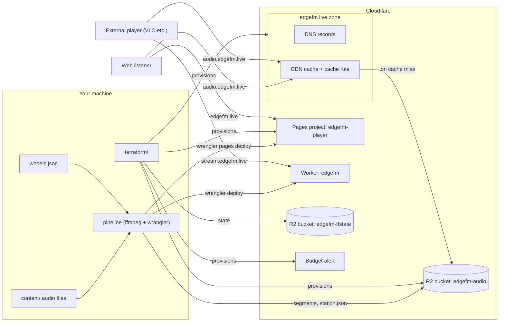
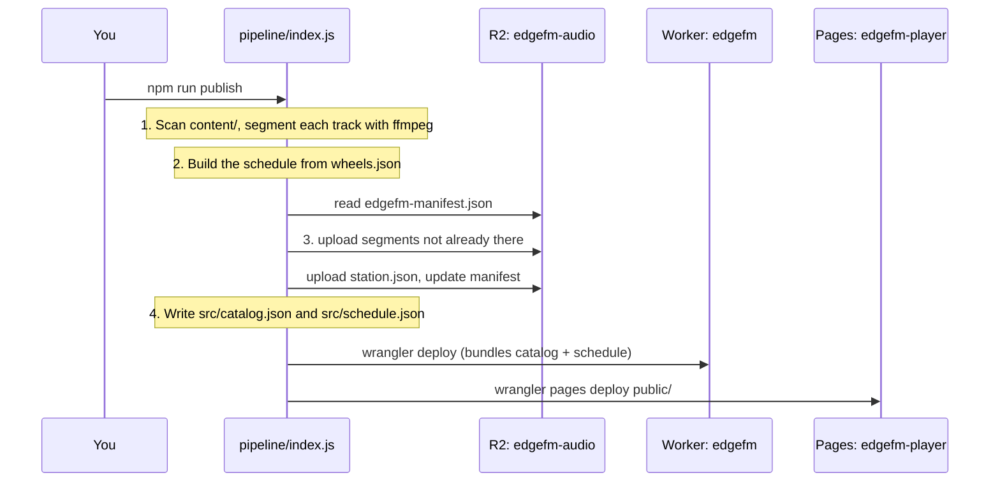
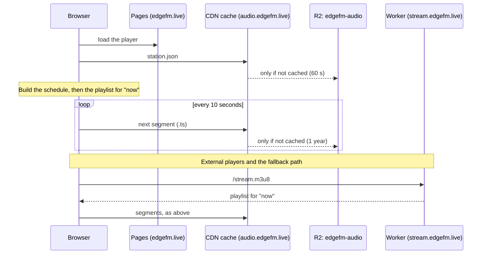

# Architecture

EdgeFM is a radio station with no streaming server. Audio is cut into 10-second files ahead of time and stored in Cloudflare R2. A listener's player works out which files are "on air" right now from the clock and a schedule, then downloads them through Cloudflare's CDN. Everything runs on Cloudflare's free tier.

This page describes the deployment on `edgefm.live`. The hostnames come from the `domain` variable in `terraform/` and the URLs in `wrangler.toml` and `public/index.html`.

## Infrastructure

| Component | Address | What it does | Managed by |
|---|---|---|---|
| Pages project `edgefm-player` | `edgefm.live`, `www.edgefm.live` | Serves the web player (`public/`) | Terraform creates it; `npm run publish` uploads the files |
| R2 bucket `edgefm-audio` | `audio.edgefm.live` | Holds the audio segments, `station.json` and the upload manifest | Terraform creates it; the pipeline fills it |
| Cache rule | `audio.edgefm.live` | Makes every file on the audio host cacheable at the edge | Terraform |
| Worker `edgefm` | `stream.edgefm.live` | Builds the live playlist for players that can't run the web player's code | `wrangler deploy` (route in `wrangler.toml`) |
| DNS records | `edgefm.live`, `www` | Point the site at the Pages project | Terraform |
| Budget alert | — | Emails when usage charges reach the threshold | Terraform |
| R2 bucket `edgefm-tfstate` | — | Terraform state | Created once by hand with wrangler |
| Zone `edgefm.live` | — | The domain itself | Added in the dashboard; Terraform only looks it up |

## Publishing

`npm run publish` is the only way content, the schedule or the player reach listeners. It runs on your machine because that's where the audio files are.

1. **Segment.** Each audio file becomes 10-second AAC segments (128 kbps stereo, MPEG-TS). A track's ID is a hash of its audio plus the encoding settings, so renaming or moving a file changes nothing, and changing the audio produces new files.
2. **Schedule.** `public/lib/schedule.js` lays tracks out over 30 days using the clock wheels in `wheels.json` and a seeded random pick. The same input always gives the same schedule.
3. **Upload.** Segments go to `segments/<id>/<id>_NNN.ts`. The manifest in the bucket records what has been uploaded, so only new segments are sent. `station.json` (the wheels plus the track catalog) is uploaded after the segments, so a player never sees a track whose audio isn't there yet.
4. **Deploy.** The Worker is deployed with the catalog and schedule bundled in, and the player is uploaded to Pages. Deploying them together keeps the Worker, `station.json` and the player on the same scheduling code.

Old segments are never deleted automatically; `npm run prune` removes the ones nothing uses.

## Listening

**Web player.** The page loads `station.json`, rebuilds the schedule with the same code the pipeline used, and hands hls.js a playlist it generates itself from the current UTC time. It re-checks `station.json` every 5 minutes to pick up a new publish. A normal web listener never calls the Worker.

**External players.** VLC and similar players can't run that code, so they fetch `/stream.m3u8` from the Worker about every 10 seconds. The Worker builds the same playlist from its bundled schedule. The web player also falls back to the Worker when the browser can't run hls.js (older iPhones) or `station.json` can't be loaded.

**Segments.** Both kinds of player download the audio itself from `audio.edgefm.live`. The Worker never serves audio.

## How everyone hears the same thing

Nothing is pushed to listeners, so being in sync comes from everyone doing the same arithmetic:

- The station started at a fixed moment, `EPOCH` in `public/lib/schedule.js`. Don't change it once live.
- The schedule is a 30-day loop. Seconds since `EPOCH`, modulo 30 days, gives a position in the loop, which gives a track and a segment within it.
- The playlist is a six-segment window around that position: three behind, the current one and two ahead. Its sequence number is the count of 10-second segments since `EPOCH`.
- The web player corrects for a wrong PC clock by comparing against the web server's `Date` header.

Because the pipeline, the Worker and the web player all import `public/lib/schedule.js` and `public/lib/playlist.js`, they produce identical playlists.

## Caching and cost

R2 has no bandwidth charge; it bills for reads and writes beyond a free monthly allowance. A read only happens when Cloudflare's edge doesn't already hold the file, so caching is what keeps the station free.

| File | `Cache-Control` | Effect |
|---|---|---|
| Segments (`.ts`) | `public, max-age=31536000, immutable` | Each edge location reads a segment from R2 once, then serves every listener from cache |
| `station.json` | `public, max-age=60` | At most one R2 read a minute per edge location |
| `edgefm-manifest.json` | `no-store` | Only the pipeline reads it |
| Worker `/stream.m3u8` | `public, max-age=5` | Every request runs the Worker; counts against 100,000 requests a day on the free plan |

`.ts` and `.json` are not among the file types Cloudflare caches by default. The cache rule in `terraform/main.tf` makes everything on `audio.edgefm.live` cacheable and tells the edge to honour the headers above.

Cost therefore depends on how many edge locations have listeners, not on how many listeners there are. The first limit a busy station hits is the Worker's daily request allowance, which external players consume and web listeners don't; past it the stream URL returns errors until midnight UTC but nothing is billed.

Cloudflare has no hard spending cap. The budget alert in `terraform/notifications.tf` emails when usage charges reach `budget_alert_dollars`.

## What manages what

| Tool | Owns | Run it when |
|---|---|---|
| Terraform (`terraform/`) | R2 audio bucket, CORS, its custom domain, the cache rule, the Pages project and its domains, DNS records, the budget alert | Infrastructure changes |
| `npm run publish` | Bucket contents, the Worker and its `stream.` domain, the deployed player | Content, schedule or player changes |
| `npm run deploy:player` | The deployed player only | Player-only changes |
| Cloudflare dashboard | The account, the zone and its nameservers, the R2 subscription, API tokens | One-time setup |
